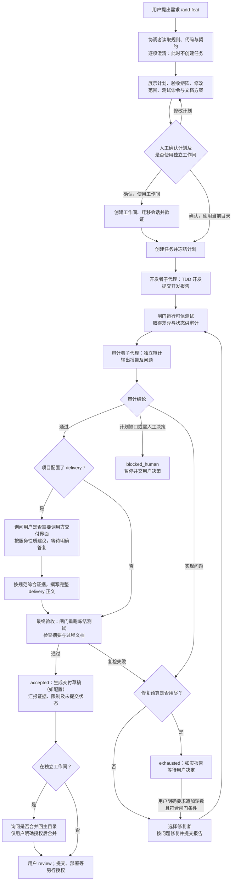

# add-feat 使用说明

面向使用者的功能与操作文档。add-feat 是一个 OpenCode 插件，在**普通会话窗口内**提供多模型开发工作流：你提需求，它负责澄清、计划、开发、独立审计、按需修复和最终验收，全程留下可信证据。

---

## 1. 它是什么

一条"开发流水线"，由一个协调者和四个专职角色组成，通过 OpenCode 原生 subagent 机制在你的当前项目里工作：

```
你 ──需求──> 协调者 Sol（澄清 → 计划 → 等你确认 → 调度 → 验收）
                │
                ├─ 开发者（GLM-5.3）：TDD 实现，只改计划允许的文件
                ├─ 审计者（GPT-6.1-Terra）：独立审计，可运行复现验证（/tmp 脚本 + 一次性容器），不改仓库
                └─ 修复者（GLM-5.3 / GLM-5.3-Flash）：按审计编号最小修复
```

关键设计：**编排在 agent 层，强制规则在插件层**。阶段推进、测试执行、改动核验由插件在服务端完成，模型口头说"通过了"不算数。

改动一致性核验（防"测的是 A、审的是 B、验收的是 C"）按**任务范围**强制：计划冻结后只对 `allowedPaths` 内代码 + HEAD commit 做逐内容摘要比对，范围外文件变化仅作为警告附注转述、不影响任务判定；澄清期间的工作区变化不再作废任务，而是在冻结时重置基线并留痕。过程文档完整性（哈希登记）仍然全域独立强制。

## 2. 前置要求

- OpenCode V2（本说明基于 2.2.1 验证）。
- 在 **git 仓库**内使用（改动核验依赖 git；非 git 目录会拒绝开始任务）。
- 默认模型需要可用：`openai/gpt-6.1-sol`、`openai/gpt-6.1-terra`、`zhipuai-coding-plan/glm-5.3`、`zhipuai-coding-plan/glm-5.3-flash`（换模型见 §6.3）。
- 使用者终端里 `opencode` 命令可用。

## 3. 安装

标准安装走 GitHub 仓库，见 [README 安装节](../README.md#安装)。简述：

```bash
opencode plugin add github:wyn-ying/add-feat     # 插件本体
npx github:wyn-ying/add-feat                     # agents / 命令 / 默认配置落盘
node ~/.config/opencode/add-feat-model.mjs show                      # 按需切换角色模型
opencode service restart                          # 必须重启（热重载不可靠，见 §8）
```

本地开发或不想用脚本时，对应的文件位置如下（`install.mjs` 会完成同样的落盘）：

| 路径 | 作用 |
|---|---|
| `~/.config/opencode/agents/add-feat.md` | 协调者 Sol |
| `~/.config/opencode/agents/add-feat-developer.md` | 开发者 |
| `~/.config/opencode/agents/add-feat-auditor.md` | 审计者 |
| `~/.config/opencode/agents/add-feat-fixer.md` | 修复者（高复杂度） |
| `~/.config/opencode/agents/add-feat-fixer-flash.md` | 修复者（中低复杂度） |
| `~/.config/opencode/commands/add-feat.md` | `/add-feat` 入口命令 |
| `~/.config/opencode/add-feat-docs/` | 过程文档与交付撰写规范（agent 固定读取此目录，与插件安装位置解耦） |
| `~/.config/opencode/add-feat.json` | 默认配置（修复轮数、测试超时），已存在则不覆盖 |

验证：新开会话执行 `/add-feat 你好`，若协调者回应并开始澄清，即安装成功。

## 4. 快速开始

在你的项目目录打开 OpenCode 会话：

```text
/add-feat 实现用户邮箱格式校验 --max-repairs 2
```

主要需要在以下时刻回应它：

1. **澄清（质询式）**：有 `grilling` skill 时自动加载其方法论（内部用设计树/frontier 组织问题，仍保持一次一问）；没有则用内置的精简协议。它对需求有疑问会一次问你一个问题，每个问题附推荐选项和取舍说明；能从代码里查清的它不会问你。一轮结束时它会汇总"已达成共识/未决项"。
2. **确认计划**：它会展示目标、允许修改的文件范围（allowedPaths）、验收命令，然后停下来等你回复"确认"。**这个停顿由协调者的角色提示约束**（提示层纪律）：插件层强制的是阶段顺序与证据闸门——即没有 `confirm_plan` 就进不了开发阶段，且开发前测试/审计/验收每一步都要过插件的服务端核验。存在未决项时它不会请求确认。
3. **选择工作间**：明确回答是否使用独立工作间；这与计划确认都完成后才开始任务。
4. **选择交付界面**：项目配置 delivery 时，审计通过后、撰写前回答是否需要面向调用方的完整接口交付界面；协调者会按服务性质给建议。不配置 delivery 时不要求这一步。

修复轮数耗尽、需要人工决策或工作间交付后的合并等情况，也需要你决定，见流程图（§4.2）和 §5。

确认后自动执行：开发（TDD 红绿）→ 服务端独立跑验收命令 → 独立审计 →（有问题：按复杂度选修复者修复并复审，最多 N 轮）→ 最终验收（重新跑全部验收命令并核对代码与审计时一致）→ 给你最终报告。

## 4.1 快速切换角色模型

套餐用完或需要备用模型时，用 `~/.config/opencode/add-feat-model.mjs` 一条命令切换，不必手工找文件改 `model:`：

```bash
# 查看全部角色当前模型（标注哪些被覆盖过、哪些已不在可用清单）
node ~/.config/opencode/add-feat-model.mjs show

# 切换：不传模型 ID 会弹出交互选择器（从 opencode models 清单里过滤选择）
node ~/.config/opencode/add-feat-model.mjs set developer
node ~/.config/opencode/add-feat-model.mjs set developer zhipuai-coding-plan/glm-5.3-flash

# 还原出厂模型
node ~/.config/opencode/add-feat-model.mjs unset developer

# 模型确实存在但暂不在当前清单（如仅其他项目可用）时跳过校验
node ~/.config/opencode/add-feat-model.mjs set auditor openai/gpt-6.1-terra#high --force
```

角色：`coordinator`、`developer`、`auditor`、`fixer`、`fixer-flash`。

- 脚本只在 agent 文件 frontmatter 内整行替换 `model:`，其余内容零改动；首次覆盖时把出厂值记入 `~/.local/state/add-feat/model-overrides.json`，`unset` 据此还原，不留 `.bak` 文件。
- 模型 ID 必须存在于 `opencode models` 清单，拼写错误会被拒绝并给出相似候选。
- 运行中的子代理不受影响，下一个子代理生效；**子代理运行中切换会造成同阶段混用两个模型**，尽量等阶段结束。改完若未自动重载，执行 `opencode service restart`。

### 4.2 执行流程图



- **人工确认的边界**：图中的计划、工作间及交付界面询问是协调者的执行纪律；阶段顺序、测试和摘要检查由插件闸门执行。审计通过或 `accepted` 都不等于人工验收、提交或上线。
- **失败与中止**：需要人工决策时不自动改计划；用户可按实际状态选择中止。强制范围或已登记过程文档发生协议外变化可能进入 `tampered`，须先核查，不通过重置状态掩盖。详见 §5、§7。
- **终态后**：普通工作可继续。需要补写已验收 delivery 时，可按 §4 的 `revise_delivery` 条件办理；若条件不满足，用户可在项目规则允许时授权普通文档修订，但它不是原验收的一部分，也不会更新闸门登记。

最终报告包含：结论、改动文件、测试证据（真实命令与退出码）、修复轮次使用、未覆盖风险；并明确**改动未提交**，由你 review 后自行提交。

配置了 delivery 的项目，协调者须在最终验收前按[delivery 撰写规范](delivery撰写规范.md)综合适用 plan、全部轮次 dev/audit 与实际代码，写出按工程主题组织的交接参考（范围、架构、接口、存储、逻辑、UI、安全、验证及限制），通过 `final_accept.report` 交插件落盘。插件强制正文非空并追加真实复检证据，不再以"需求 + 退出码"生成替代正文；内容质量仍依赖协调者按规范自检，不等于另有独立文档审计。历史 accepted 任务不自动重写。

**过程文档质量**：plan / dev / audit / README 均受[过程文档撰写规范](过程文档撰写规范.md)约束（标杆：统一账号服务任务的证据链质量）。插件层强制三件事：`end_audit` 无完整报告正文拒绝（纯 JSON 结论不归档）；`end_dev`/`end_fix` 报告过短拒绝（小任务允许简化但须写明依据与验证）；README 由服务端按导航模板生成（有效计划链接、轮次报告表、未关闭问题清单、代码与交付状态）。缺项由协调者退回原角色补全，修复轮补文档不消耗额外预算。

**验收后完善交付文档**：在原协调者会话明确授权将完整新版正文写入原 delivery 文件；协调者使用 `revise_delivery`，不重新执行开发或验收。插件仅允许 accepted 且代码摘要/过程文档完整性仍匹配的原登记路径；先在仓库外备份旧正文，再替换及登记新哈希，并记录原话和理由。修复预算、验收结果、关闭时间不变；测试证据标为历史引用而非本次重跑，仍保留未经人工确认提示。路径不同、工作区变化或完整性失败时会拒绝，不应手工修改状态绕过。落盘授权不授予提交、部署或人工验收状态。

任务终态后普通编辑不再被 add-feat 阶段限制。若历史任务已不在当前任务槽或 `revise_delivery` 因摘要变化拒绝，用户可在项目规则允许的前提下明确授权普通文档修订：这是新修订，不属于原验收，不会更新闸门登记；直接编辑登记文档会令原哈希失配，未来终态后闸门动作可能拒绝。活动任务过程文档仍受保护。协调者自身的编辑权限仅在开发、审计或修复子代理运行时由插件拒绝；其他阶段编辑仍可能触发摘要或文档完整性检查。普通 Build agent 的权限不由该协调者限制控制。

**终态后登记复核记录**：exhausted/accepted 任务可用 `append_audit` 把事后整体复核（如"限定范围技术复核、1 项失败、非独立审计"）登记为下一个空位的 audit 文档——终态、轮次、关闭时间与历史结论不变，正文必须自带性质标注。这是记录通道，不是修复通道：继续修复走 `extend_budget`。

## 5. 你需要在什么时候出手

| 时刻 | 你做什么 |
|---|---|
| 澄清阶段 | 回答问题（一次一个） |
| 计划确认 | 阅读 allowedPaths 与验收命令，回复"确认"或提修改意见 |
| `blocked_human` | 审计判定存在计划缺口或需人决策的问题（如范围、方案选择）。处理后在同目录重新 `/add-feat` 开新任务 |
| `tampered` | 工作区在协议外被修改（如审计期间有人改了代码）。任务已自动终止并落盘证据；检查改动来源，必要时 `git diff` 复原，然后重新开任务 |
| `exhausted` | 修复轮数用尽仍未通过。三选一：要求追加轮数继续（见 6.1）、放宽验收/扩大授权后重开、或人工接管 |
| 中途放弃 | 直接告诉协调者"中止任务"，它会调用 `abort_task` 记录原因并关闭任务 |

任务结束（通过或上述终态）后，同一目录可直接开新任务。

### 5.1 并行：独立工作间（worktree）

计划确认前它会问「是否在独立工作间运行此任务」。选"是"时：

- 它把当前目录的**全部未提交成果**复制到旁边的独立工作间（并在工作间分支内做一次快照存档——该存档只存在于工作间分支，主目录零改动），然后把当前会话迁移过去：澄清、开发、验证都在工作间进行，主目录里跑的任务完全不受影响；
- 验收通过后，你明确说"确认合并"，它把改动以补丁形式应用回主目录（**保持未提交**供你 review），干净落地会自动删除工作间和临时分支；出现冲突（共享文档索引最常见）则保留工作间和补丁文件，由你人工融合后再删——它保证不会半途应用；
- 过程文档（plan/dev/audit/delivery/README/索引）按**任务登记的清单**单独搬运回主目录，不依赖 git 是否跟踪。即使你把 `dev.*`/`audit.*` 写进 `.gitignore`，它们也不会在合并时丢失，并且回到主目录后继续保持被忽略、不进入提交；未登记的忽略文件不会被顺带复制；
- 注意：工作间是新目录，前端任务需先 `npm install` 才能跑前端测试；`server/.env` 等被 gitignore 的文件不会被继承（本工作流测试均用合成环境/容器，不受影响）。

选"否"则和以前完全一样：任务直接在主目录运行，同一时间主目录只能有一个任务。

## 6. 参数与自定义

### 6.1 修复轮数

```text
/add-feat 需求 --max-repairs 3      # 首轮开发之外最多 3 轮修复（1–8）
```

不传时取 `~/.config/opencode/add-feat.json` 的 `maxRepairs`（默认 4）。轮数在你确认计划时冻结；**轮数耗尽（exhausted）后你可以明确要求追加**：对协调者说"再加 X 轮继续修"，它会调用闸门 `extend_budget`（必须逐字引用你的原话作授权留痕，模型不得自行提议或代加）——任务自动恢复修复循环。每次追加 1–8 轮，总上限 16；除 exhausted 外的终态（accepted/tampered/cancelled/blocked_human）不可追加。追加与原话都记入任务日志与 journal，可审计。

### 6.2 默认配置

`~/.config/opencode/add-feat.json`：

```json
{
  "maxRepairs": 4,
  "testTimeoutSeconds": 120
}
```

### 6.3 换某个角色的模型

编辑对应 agent 文件的 `model:` 一行，例如审计者换模型：

```yaml
# ~/.config/opencode/agents/add-feat-auditor.md
---
model: openai/gpt-6.1-sol      ← 改这里
---
```

格式 `提供商/模型`，可加 `#变体`。改完 `/reload` 或重启后生效。建议先用 `/models` 确认模型 ID 存在。

### 6.4 改入口命令名

命令名即文件名。把 `~/.config/opencode/commands/add-feat.md` 重命名为 `devflow.md`，命令就变成 `/devflow`。注意不要与其他命令重名。

## 7. 状态与证据

任务状态按项目目录分文件存放在 `~/.local/state/add-feat/`：

- `state-<目录哈希>.json`：任务全量状态（阶段、计划、轮次、问题清单、测试结果、过程文档登记、**绑定会话**、操作日志）。任务绑定创建它的会话：跨会话仅能查看状态或中止。
- `journal-<目录哈希>.jsonl`：闸门调用与 subagent 派发流水（保留最近 500 条）。

阶段流转：

```
planning（等你确认计划）
  → dev_ready → dev_running（开发者工作中）
  → audit_ready → audit_running（审计者独立复核，可运行复现验证）
      审计通过 → accept_ready → accepted（最终验收通过）
      审计失败 → fix_ready → fix_running → 回 audit_ready（循环，最多 N 轮）
  终态：accepted / exhausted（轮数用尽）/ blocked_human（需人决策）
       / tampered（协议外改动）/ cancelled
```

### 7.1 过程文档：按"你项目的规则"落地（v2）

add-feat 不内置任何特定项目的文档约定。澄清阶段，协调者会读项目 AGENTS.md（含 `docs/AGENTS.md` 等分层规则）并提取该项目的**过程文档约定**——任务目录、plan/dev/audit 命名、是否要任务 README/索引/delivery——整理成 `docRules` 随计划一起展示（注明来源），**你确认计划时一并确认**。之后各文档由插件在服务端按这套规则写入仓库：

- 冻结计划时：plan 文档（你看到的完整计划正文）、任务 README、索引条目；
- 每轮开发/修复交付：dev 文档（开发者完整报告）；
- 每轮审计：audit 文档（审计者完整报告）；
- 最终验收通过：delivery **草稿**（文内带"AI 验收通过、未经人工确认"提示，人工确认后请移除提示并定稿）。

项目没有相关规则时使用内置默认（`docs/cowork/{任务}_{日期}/` + `plan.v1.rN.日期.md` 风格），并在计划中标注"add-feat 默认"。**换一个项目、换一套约定，add-feat 自动跟随**——规则解释一次、随计划冻结、由闸门机械执行。

注意：过程文档由插件写入并持续校验。**手动改这些文件会在下一阶段边界被判 tampered**（这是防止"改 plan 内容冒充已批准计划"的机制）；如需人工修订，最好在任务终态后进行。

### 7.2 tampered 的判定原理

插件在关键边界给整个工作区算"内容指纹"（git HEAD + 状态 + 差异 + 每个未跟踪文件的内容哈希）并比对：

| 边界 | 防什么 |
|---|---|
| 冻结计划 | 计划定稿期间代码变了（计划可能过时/存在并发修改） |
| 审计开始↔结束 | 审计结论只对被审代码有效，审计期间代码不能变 |
| 最终验收 | 审计通过后代码不能再变 |

哈希只能说明"有东西变了"，不能说明"谁、为什么"，所以一律停下交人核对（fail-closed）。报错会附带当前工作区相对 git HEAD 的脏文件清单。本任务的过程文档已被**精确排除**在指纹之外（插件写入它们不会误报），且每个文档登记了内容哈希——**改动过程文档本身同样触发 tampered**，排除区不是盲区。规划期间想补资料：先放好文件，再创建任务；或中止任务（abort_task）后重开。

## 8. 运维注意事项

- **修改插件源码后必须 `opencode service restart`**。OpenCode 对插件的热重载存在模块缓存，`/reload` 不可靠；开发期可用"重命名模块文件"规避，日常使用请直接重启。
- 服务端日志：`~/.local/share/opencode/log/opencode.log`（查 `add-feat` 关键字可看插件加载失败原因）。
- 插件单元测试：`cd ~/.config/opencode/plugins/add-feat && bun test`（不调用任何模型）。

## 9. 安全边界（请务必阅读）

**它不是沙箱。** 与容器隔离方案不同，本工作流的开发/修复角色拥有你工作区内的真实文件编辑与 shell 执行能力。因此：

- 它**能防**（插件层，服务端强制）：阶段跳跃（未过闸门就开发/审计/修复）、空口通过（测试由插件服务端真实执行）、审计后偷改代码（git 摘要闸门，含验收复检期间的二次核对）、超预算修复、审计者改代码（仓库文件对其只读 + 摘要检测；其 shell 复现只允许 /tmp 与一次性容器）、协调者直接写代码（无编辑权限）、其他会话直接调用工作流角色（权限钩子限定调用者与阶段）。
- "呈现计划后等你确认"属于**提示层纪律**（协调者角色提示要求先确认再 `confirm_plan`），不是插件强制的身份核验；插件保证的是没有 `confirm_plan` 阶段动作就无法进入开发。
- 它**不能防**：开发者/修复者通过 shell 理论上可做权限外的事（包括读写任务状态文件——各角色的文件工具已显式拒绝 `~/.local/state/add-feat/**`，但 shell 无法既放开跑测试又完全封死；这是选择"直接在工作区开发"的既定代价）。恶意提交/推送同理（工作流自身绝不执行 git 提交）。
- 同一目录同时只应运行**一个** add-feat 会话：闸门按目录记录单一任务，第二个 `start_task` 会被拒绝；且任务**绑定创建它的会话**（sessionID 服务端注入）——其他会话只能查看状态或 `abort_task` 中止（恢复阀），不能推进或改冻结计划。需要并行开发时，用 **git worktree**（如 `opencode worktree create feat-a`）：每个 worktree 是独立目录，拥有独立任务状态与排除清单，天然完全隔离，无需任何额外配置。原会话丢失时：新会话 `abort_task` 中止旧任务后重开，或删除 `~/.local/state/add-feat/state-<目录哈希>.json`（最后手段）。
- git 忽略的路径对改动摘要不可见（摘要基于 git 跟踪文件 + 未忽略的未跟踪文件）；依赖 ignored 文件的场景请在计划中说明。
- 重要分支建议在干净工作区使用；开始任务前它会记录当前 git 状态，但不会替你回滚任何东西。
- 全程不自动 `git commit`/`push`；交付即工作区里的未提交改动。
- token/费用只有轮数与超时约束，**没有费用硬上限**；大任务请留意用量。

## 10. 故障排查

| 现象 | 处理 |
|---|---|
| 协调者说"没有 addfeat_gate 工具" | `opencode service restart` 后重试（多为插件未加载，查日志确认） |
| subagent 启动被拒，提示"只能在 X 阶段" | 正常行为：说明流程顺序错了，按闸门提示的顺序走（通常是跳过了某步 gate 调用） |
| `begin_audit` 被拒"没有可信测试证据" | 先 `run_checks`；代码变动后需重新 `run_checks` |
| 中途想放弃任务 | 让协调者调用闸门 `abort_task`（附原因），任务转为 cancelled 后即可重新开始；planning 阶段也可直接 `cancel_task` |
| 闸门提示"任务由其他会话创建并绑定" | 任务只认创建它的会话。回原会话继续；或在新会话 `abort_task` 中止后重开；原会话彻底丢失且状态损坏时才删状态文件 |
| 状态文件损坏/想彻底重置 | 关闭相关会话后删除 `~/.local/state/add-feat/state-<目录哈希>.json`（最后手段；正常流程用 abort_task） |
| `testCommands` 超时 | 调大 `add-feat.json` 的 `testTimeoutSeconds`（上限 300），或拆分验收命令 |
| 想放弃当前任务 | planning 阶段可直接让协调者 `cancel_task`；进入开发后只能等终态或人工处理（设计上不允许中途丢弃，防止半成品状态被误判） |

## 11. 卸载

1. 删除 `~/.config/opencode/plugins/add-feat/`。
2. 删除 `~/.config/opencode/agents/add-feat*.md`、`~/.config/opencode/commands/add-feat.md`、`~/.config/opencode/add-feat.json`。
3. `opencode service restart`。
4. （可选）清除历史状态：`rm -rf ~/.local/state/add-feat`。

## 12. 验证记录（2026-10-31）

**v2（过程文档落地）验证：**

- 39/39 单元与集成测试通过（状态机+文档落地 26、git 摘要/规则集成 13，零模型）。
- 动态规则端到端：夹具项目声明自定义中文约定（`过程记录/{任务}_{日期}/`、`计划.r1`/`开发.r{轮}`/`审计.r{轮}`/`交付_v1`/`说明.md`/`索引.md`），协调者从 AGENTS.md 正确提取并随计划呈现（来源标注、任务名按项目风格），非内置默认方案。
- **全链一次通过**：grill-me 一次一问 → 共识/未决项汇总 → 计划+文档方案停等确认 → 确认后按项目自定义路径落地全套文档（计划/开发/审计/说明/索引/delivery 草稿）→ 开发→服务端测试（退出码 0）→ 审计 → 验收复检 → `accepted`（0/2）。delivery 草稿带"AI 验收通过、未经人工确认"水印。
- 首次 v2 冒烟曾误报 tampered，定位为 porcelain -z 多条目解析串接缺陷（排除机制失效），已修复并新增"排除路径在场/不在场摘要必须一致"回归；该缺陷在单条目状态的工作区不会触发，v1 期间因此未暴露。
- 摘要排除区：登记路径不可见、同目录邻居可见、tracked 共享索引修改排除、过程文档改动可检出（单测覆盖 + 真实链路无误报复跑验证）。
- 修复过程中发现并修正：taskSlug 正则 `\w` 含下划线与项目规则冲突。

**v1 验证（仍有效）：** 完整通过路径、真实修复分支（Flash）、blocked_human 终态、人工确认停顿、权限钩子负向拒绝（非协调者启动被硬拒）、28 项测试；复审阻断项（终态不落盘→任务卡死）已修复并回归覆盖。

已知未验证/限制：超大型仓库的摘要性能未测；tampered 与验收复检失败的真实模型路径仅单元覆盖；多用户共用同一目录未设计；token/费用无硬上限；状态文件格式 v2（旧 v1 状态首次加载会重置，历史结论以仓库内过程文档为准）。

---

*验证记录见插件目录 `README.md` 与 `.slim/deepwork/add-feat.md`。*
